# Monster Hunter Portable 3rd — Tradução PT-BR

Patch de tradução não oficial de **Monster Hunter Portable 3rd** para português do Brasil.

Esta distribuição contém somente as diferenças produzidas pela tradução. Nenhuma ISO, ROM ou outro arquivo completo do jogo é fornecido.

A tradução toma como referência a terminologia oficial em português do Brasil dos jogos mais recentes da série *Monster Hunter*, com adaptações ao contexto de *Portable 3rd* e às limitações de espaço do jogo original.

## Conteúdo da tradução

- Textos de menus, itens e descrições;
- descrições de armas e armaduras traduzidas, com os nomes mantidos conforme a base em inglês;
- missões, objetivos e resultados;
- diálogos, tutoriais e textos de ajuda;
- textos de interface e elementos gráficos localizados;
- padronização terminológica em português do Brasil.

## Vídeo da tradução
https://www.youtube.com/watch?v=Uh9X6GgBxfI

## Imagens da tradução

  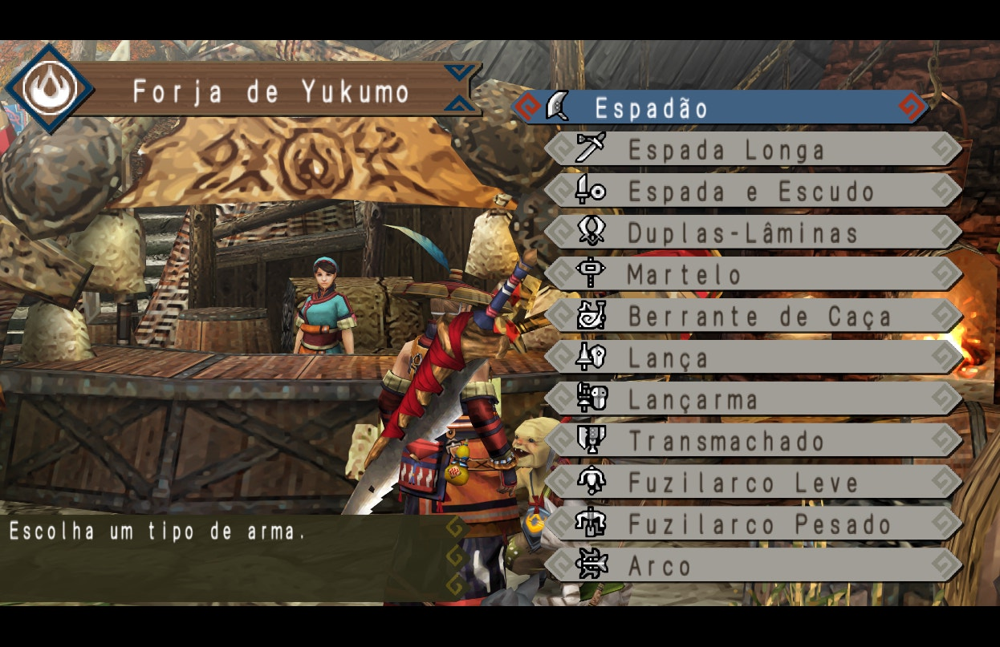
  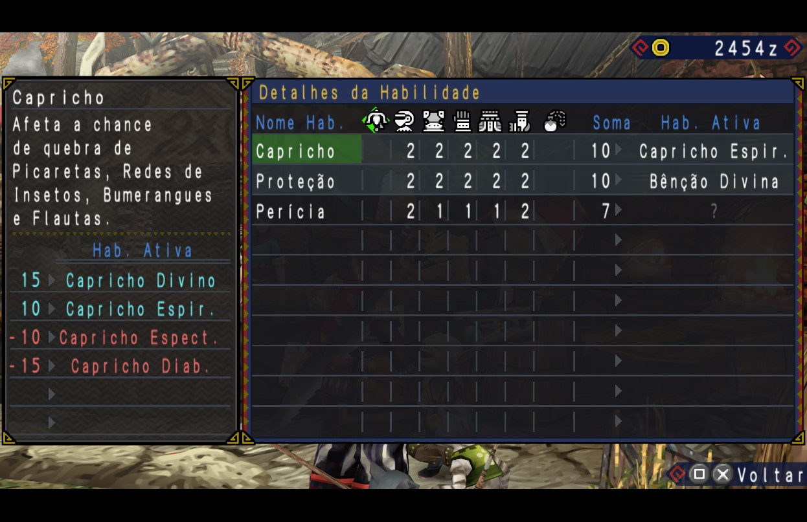

  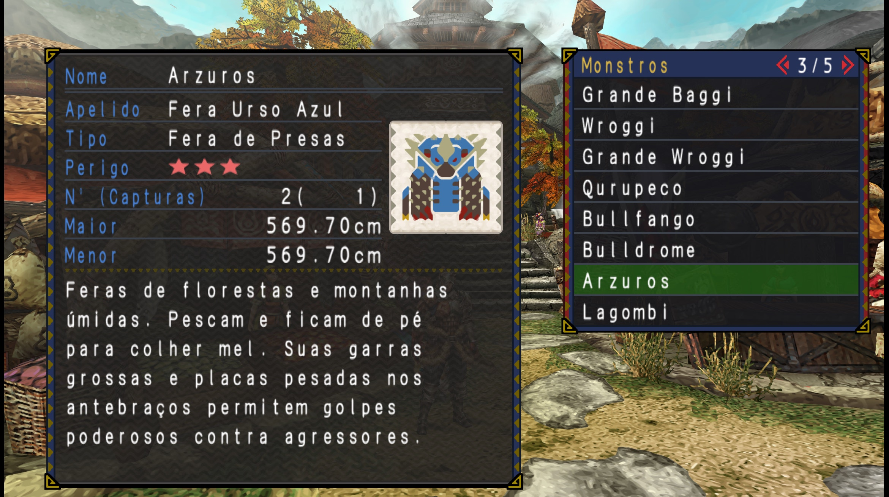
  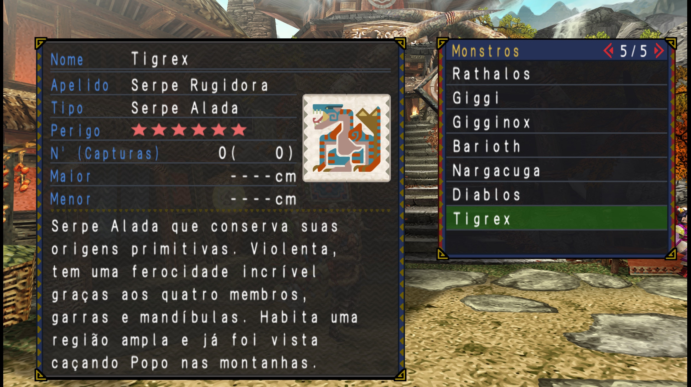

  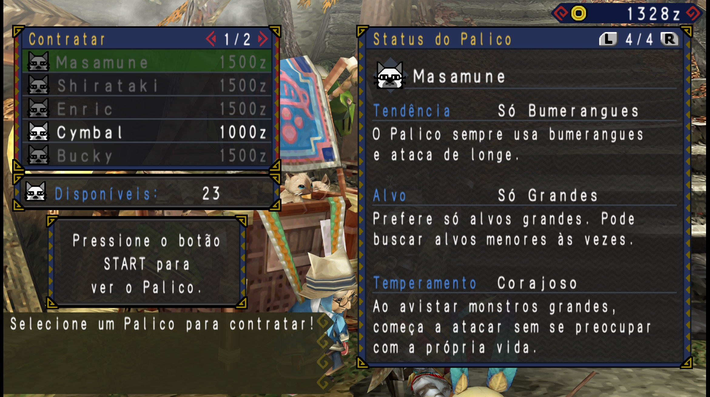
  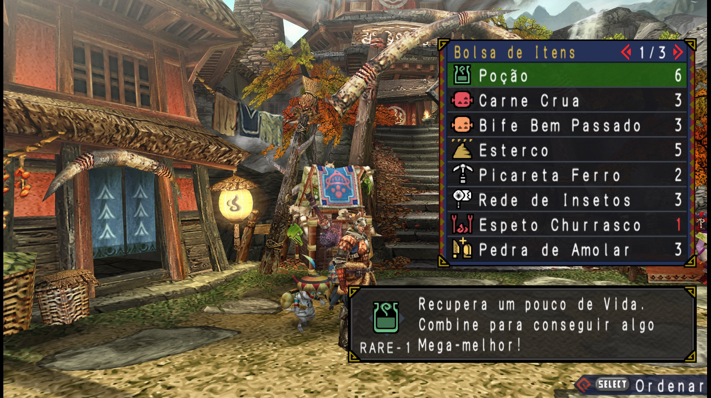

  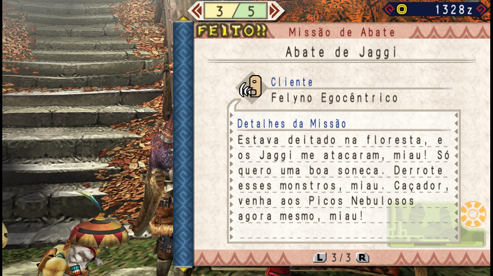
  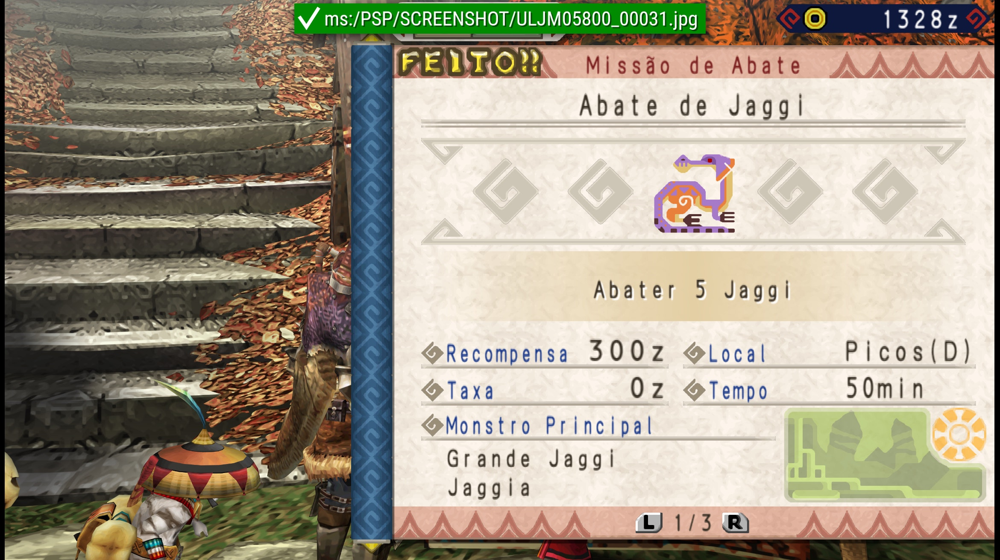

  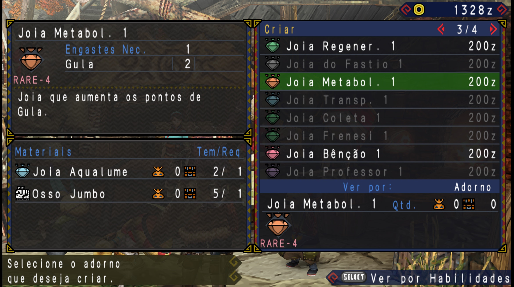
  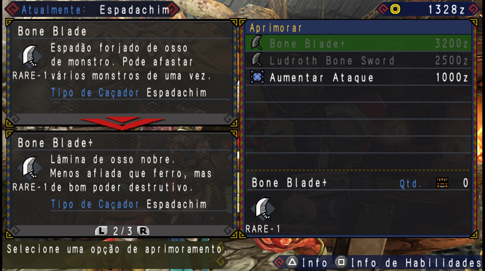

  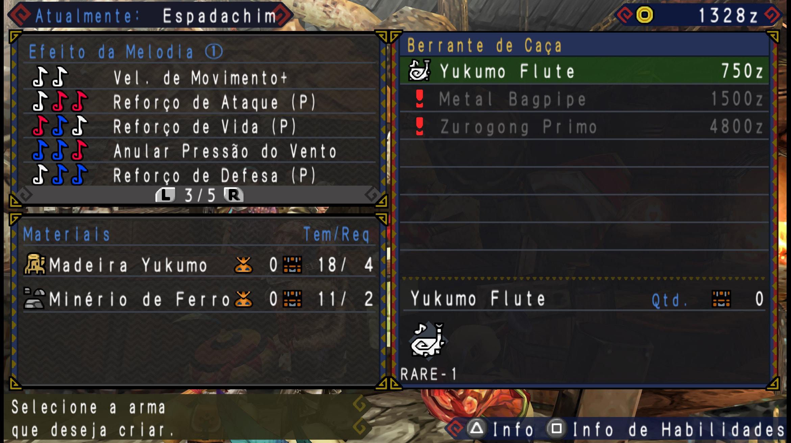

## Versão do patch

**v1.0**, primeira versão pública da tradução, lançada em 15/11/2026.

## Requisitos

- Uma cópia própria da edição japonesa de *Monster Hunter Portable 3rd* para PSP, com a tradução inglesa **v6.1.0** ou **v6.2.2** da **Team Maverick One** já aplicada.
- Um programa compatível com patches Xdelta 3, obtido pelo próprio usuário.
- Aproximadamente 1,21 GB livres para a nova ISO.

### ISOs base

| Propriedade | Inglês v6.1.0 | Inglês v6.2.2 |
| --- | --- | --- |
| Edição | PSP (Japão), Team Maverick One v6.1.0 | PSP (Japão), Team Maverick One v6.2.2 |
| ID | `ULJM-05800` | `ULJM-05800` |
| Tamanho | 1.207.140.352 bytes | 1.207.140.352 bytes |
| SHA-256 | `9f3f19f2cd58a1ed0fb2654c65c075ac9a36f38af15fa6102b602c94e9d49bbd` | `5f9a33a725da226b2cce241f1238521753f0dfd5faa85fbb9d48e3b506ef0c77` |

A ISO japonesa sem o patch em inglês, a edição HD e arquivos compactados são incompatíveis.

## Como instalar

1. Baixe o patch correspondente à sua ISO base na [Release v1.0](https://github.com/rafsiq/monster-hunter-portable-3rd-ptbr/releases/tag/v1.0).

   | ISO base | Patch |
   | --- | --- |
   | Inglês v6.1.0 | [`MHP3rd_PT-BR_v1.0_base_v6.1.0.xdelta`](MHP3rd_PT-BR_v1.0_base_v6.1.0.xdelta) |
   | Inglês v6.2.2 | [`MHP3rd_PT-BR_v1.0_base_v6.2.2.xdelta`](MHP3rd_PT-BR_v1.0_base_v6.2.2.xdelta) |

2. Instale ou baixe um aplicador compatível com Xdelta 3.
3. Selecione sua ISO base como arquivo de origem.
4. Selecione o arquivo `.xdelta` baixado como patch.
5. Escolha `Monster Hunter Portable 3rd (PT-BR) v1.0.iso` como arquivo de saída.

Confirme os hashes informados abaixo antes de jogar. Preserve a ISO original.

## Resultado esperado

| Propriedade | Valor |
| --- | --- |
| Nome sugerido | `Monster Hunter Portable 3rd (PT-BR) v1.0.iso` |
| Tamanho | 1.207.140.352 bytes |
| SHA-256 | `c780d5e6ace24d697d28a6d401027eff7516661fa9af73e65962b7d81742ec3f` |

As duas bases produzem a mesma ISO traduzida. Consulte [CHECKSUMS.md](CHECKSUMS.md) para conferir o SHA-256 de cada patch.

## Problemas conhecidos

Apesar das verificações técnicas, podem existir textos longos, quebras de linha ou caracteres que precisem de ajustes de apresentação.

Ao encontrar um problema, abra uma issue e informe o local do jogo, o texto exibido, o texto esperado e, se possível, inclua uma captura de tela.

## Aviso legal

Este é um projeto de fãs, gratuito e sem fins lucrativos. Não possui vínculo, autorização ou associação com Capcom, Sony Interactive Entertainment ou qualquer outra detentora de direitos relacionada ao jogo.

*Monster Hunter*, seus nomes, marcas, personagens, imagens e demais elementos pertencem aos respectivos titulares. Este repositório e seus pacotes de distribuição não contêm a ISO completa do jogo.

O patch deve ser aplicado somente a uma cópia obtida legalmente pelo próprio usuário. Não solicite nem compartilhe links para ISOs, ROMs ou outros conteúdos protegidos nas issues, discussões ou demais canais do projeto.

Nenhum executável de aplicação é incluído. O usuário é responsável por obter uma ferramenta compatível com Xdelta 3 de uma fonte de sua confiança.
